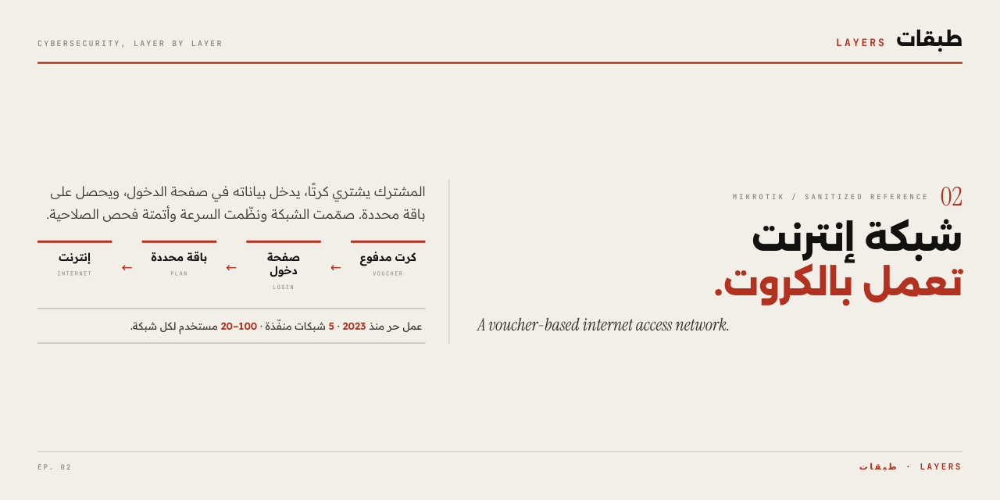

# شبكة إنترنت تعمل بالكروت — MikroTik

### Voucher-based internet access network

**طبقات · LAYERS — الحلقة 02**

---

## بطاقة الوثيقة

| الحقل | القيمة |
|:---|:---|
| **معرّف الوثيقة** | `LAYERS-MIK-001` |
| **الإصدار** | 2.1 |
| **الحالة** | صادرة |
| **تاريخ الإصدار** | 2026-11-07 |
| **التصنيف** | عام — مرجع هندسي منقّح |

> **سياسة اللغة:** واجهة المستودع بالعربية، مع إبقاء المصطلحات التقنية بالإنجليزية. المرجع الإعدادي وتعليقاته بالإنجليزية.

---

## 1. ما هذا المشروع؟

شبكة إنترنت للمشتركين تعمل بنظام الكروت.

المشترك يشتري كرتًا، يتصل بالشبكة، يدخل بياناته في صفحة الدخول، ثم يحصل على الباقة التي اشتراها: سرعة محددة، مدة استخدام، وكمية بيانات. الكرت هنا **حساب دخول**، وليس بالضرورة بطاقة ورقية.

هذا المستودع يوثّق كيف صمّمت هذه الرحلة على MikroTik، وكيف نظّمت الشبكة خلفها: تقسيم الشبكة، تنظيم السرعة، التحقق من الدخول، وفحص صلاحية الكروت.

> هوية العميل محفوظة للسرية المهنية. المادة المنشورة مرجع هندسي منقّح، وليست نسخة تشغيلية.

---

## 2. نطاق الخبرة

| المؤشر | القيمة |
|:---|:---|
| بداية العمل الحر | **2023** — نحو ثلاث سنوات متواصلة |
| شبكات منفّذة لعملاء | **ما يقارب خمس شبكات** سلكية ولاسلكية |
| حجم كل تنفيذ | **20 إلى 100 مستخدم** لكل شبكة |
| طبيعة العمل | شبكات إنتاجية حقيقية، لا بيئة مختبرية |

---

## 3. دوري في المشروع

| المجال | ما نفّذته |
|:---|:---|
| الشبكة وتقسيمها | تقسيم الشبكة إلى مجموعات بدل التعامل معها ككتلة واحدة |
| الدخول والاشتراكات | ضبط صفحة الدخول والتحقق من الحساب وتطبيق الباقة |
| السرعة والاستهلاك | حدود للسرعة والبيانات ومدة الاستخدام |
| المتابعة والصيانة | سكربتات ومهام دورية للتقارير وفحص الصلاحية |

---

## 4. كيف يدخل المشترك؟

1. يشتري كرتًا: بيانات دخول مرتبطة بباقة.
2. يتصل بالشبكة عبر نقطة وصول.
3. يفتح صفحة الدخول ويدخل اسم المستخدم وكلمة المرور.
4. تتحقق الشبكة من الحساب والباقة وحدودها.
5. يبدأ الاستخدام وفق السرعة والمدة والحجم المسموح.

---

## 5. كيف تبقى الشبكة منظمة؟

| الآلية | الوظيفة |
|:---|:---|
| **VLAN** | 19 شبكة فرعية لتقسيم الشبكة إلى مجموعات، لكل مجموعة إعداداتها |
| **Queue Tree** | حد أعلى لكل مجموعة |
| **PCQ** | توزيع السعة بين المستخدمين النشطين داخل المجموعة وفق الإعداد |
| **Mangle** | وسم الحزم لتعرف الطوابير أين تضع كل حزمة |

الهدف: تقليل التزاحم، وجعل الاستهلاك أقرب إلى الباقة المشتراة. التقسيم ينظّم الشبكة، والطوابير تنظّم الاستهلاك.

---

## 6. ماذا يحدث عند انتهاء الكرت؟

للباقات التي أعددت لها هذه القاعدة:

1. عند أول دخول تبدأ مدة الصلاحية وفق الباقة.
2. سكربت يحسب تاريخ الانتهاء ويحفظه في سجل الحساب.
3. مهمة مجدولة تفحص حسابات تلك الباقات دوريًا.
4. يُزال حساب الكرت المنتهي من قائمة الدخول.

الأتمتة تقلل المتابعة اليدوية، لكنها لا تلغي الإشراف أو الصيانة.

---

## 7. كيف أتابع الشبكة؟

| المهمة | الآلية |
|:---|:---|
| تقارير تشغيلية | سكربت يرسل ملخصًا عن الجهاز وحركة البيانات إلى Telegram |
| حسابات مركزية | User Manager / RADIUS لإدارة الحسابات وحدود الباقات |
| مهام دورية | فحص الصلاحية، تنظيف جلسات الدخول، وصيانة مجدولة |

الهدف: رؤية الحالة مبكرًا بدل انتظار الشكوى.

---

## 8. ما الذي أنشره؟

المرجع العام في `docs/reference-configuration.rsc` **مقتطف توضيحي منقّح**، وليس الملف الأصلي ولا نسخة جاهزة للاستيراد.

| محجوب | منشور |
|:---|:---|
| حسابات المشتركين وكلمات المرور | تقسيم الشبكة |
| أسرار الاتصال والإدارة | تنظيم السرعة |
| اسم العميل وهوية الجهاز | منطق فحص الصلاحية |
| عناوين ومسارات تشغيلية حساسة | المتابعة والصيانة |

الهندسة تُنشر. البيانات تبقى محفوظة.

---

## 9. القيود

| القيد | الأثر |
|:---|:---|
| راوتر واحد لكل الشبكة | نقطة فشل واحدة |
| RouterOS 6.49 | إصدار قديم؛ تدقيق أمني وتحديث مطلوبان قبل أي نشر جديد |
| حالة الكرت في حقل نصي | هشّة أمام التعديل اليدوي؛ لا تحقق من صحة الصيغة |
| لا سجل تدقيق مركزي للتغييرات الإدارية | التغييرات على الحسابات غير موثّقة مركزيًا |
| إعادة التشغيل الدورية | ليست بديلًا عن معالجة سبب المشكلة |
| المرجع منقّح ومختصر | غير قابل للاستيراد المباشر |

---

## 10. الترخيص

MIT — انظر `LICENSE`. المرجع المعروض عمل توضيحي منقّح، ولا يتضمن بيانات تشغيلية حساسة.

---

طبقات · LAYERS — الأمن السيبراني، طبقة بطبقة · الحلقة 02

